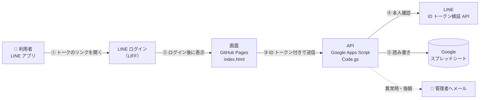
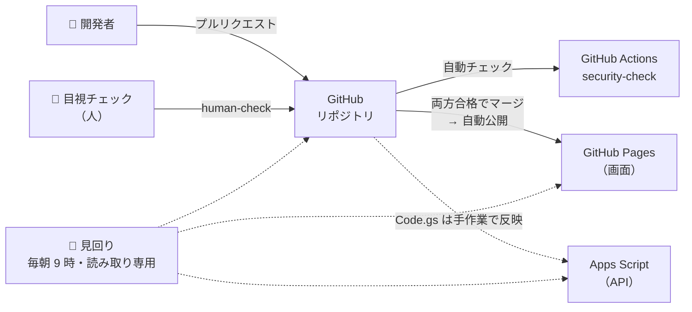
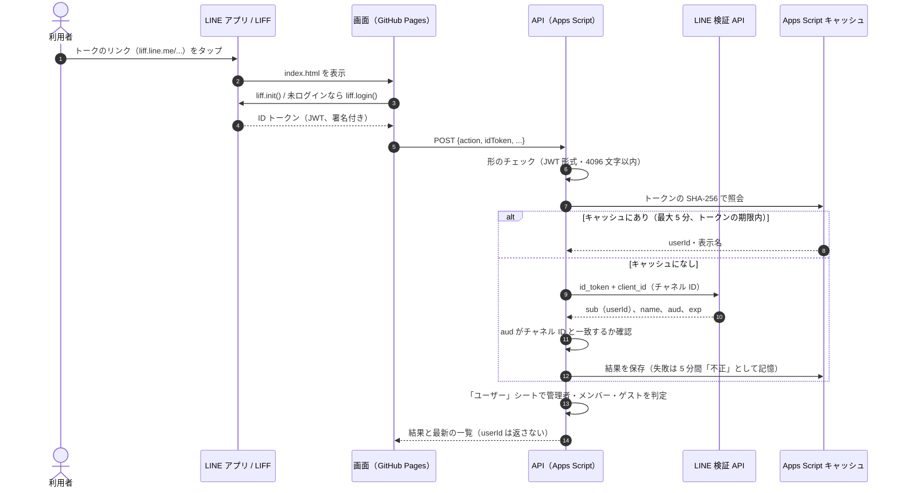
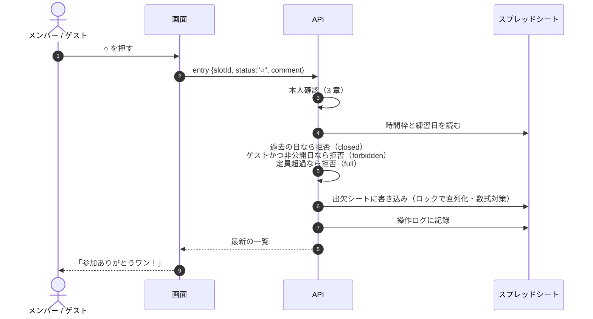
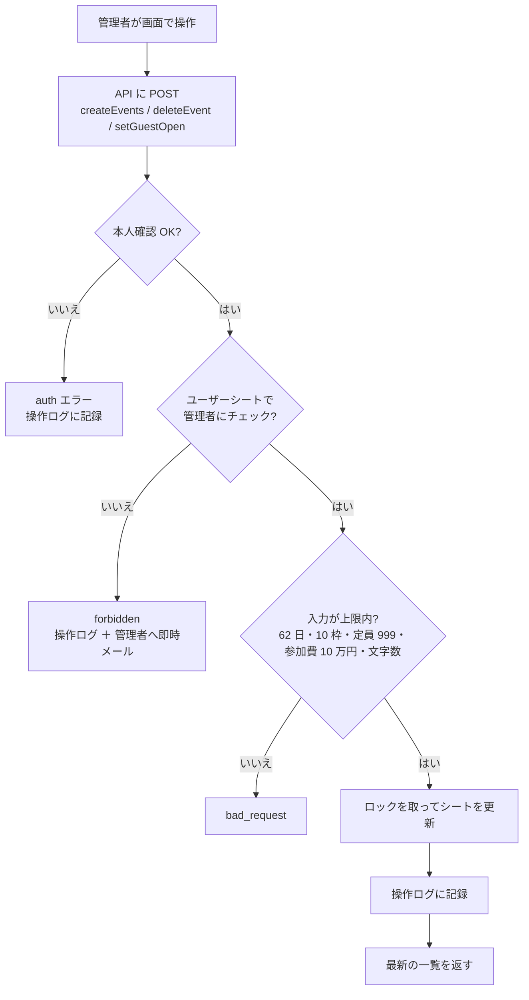
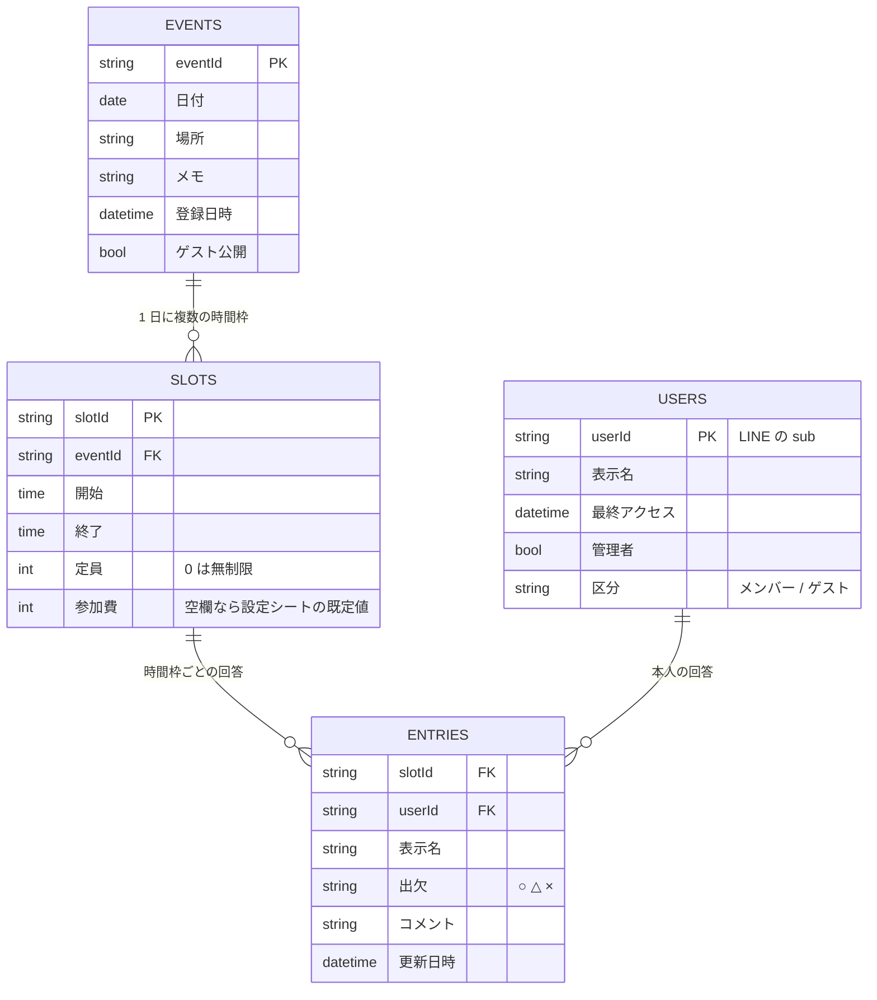
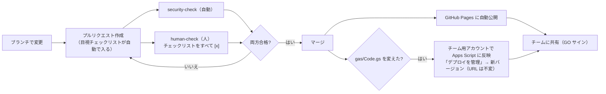

# 仕組みの全体像（システム構成・データフロー・セキュリティ）

PUG テニス練習の出欠アプリの仕組みを、初めて見る人が数分で把握できるようにまとめた資料です。
図は GitHub 上でそのまま表示されます（Mermaid）。

- 利用者：PUG メンバーとゲスト（LINE で開く）
- 管理者：練習日の登録・削除・ゲスト公開の切り替え
- 費用：すべて無料枠（GitHub Pages、Google Apps Script、Google スプレッドシート、LINE ログイン）

## 1. ひとことで

**画面は GitHub Pages の静的ページ 1 枚、サーバーは Google Apps Script（GAS）、データベースは Google スプレッドシート。**
ログインは LINE（LIFF）。画面は LINE の ID トークンを毎回 GAS に送り、GAS が LINE の検証 API で本人確認してから処理します。
画面からの名前・ID・権限は一切信用せず、権限の判定はすべてサーバー側で行います。

## 2. システム構成図

### 2-1. 使うとき（利用者 → 画面 → API → データ）

### 2-2. 作るとき・見守るとき（開発と監視）

| 部品 | 役割 | 場所 |
| --- | --- | --- |
| `index.html` | 画面のすべて（HTML/CSS/JS を 1 ファイル）。LIFF でログインし、API を呼んで描画 | GitHub Pages |
| `gas/Code.gs` | API 本体。本人確認、権限判定、読み書き、操作ログ、通知 | Apps Script（チーム用アカウント）。GitHub のものはレビュー用の原本 |
| スプレッドシート | データの保存先（下の「5. データモデル」） | チーム用アカウントの Google ドライブ |
| `scripts/review-gate.js` | マージ前の自動セキュリティチェック | GitHub Actions |
| 見回り（妖精さん） | 稼働確認、直近の変更、レビュー待ち PR の所見を毎朝 9 時にスマホへ通知 | Claude の定期タスク |

## 3. ログイン（本人確認）の流れ

- 画面が送るのは ID トークンだけです。名前・userId・権限はトークンの検証結果からサーバーが決めます。
- ID トークンそのものは保存しません（キャッシュのキーは SHA-256 ハッシュ）。
- 検証できないトークンが 1 分に 60 件を超えると、LINE への問い合わせを止めて管理者にメールします（検証 API の回数上限を守るため）。
- 認証エラーのとき、画面は自動で再ログインします。ただし連続 2 回まで（`sessionStorage` の `pugRelogin`）にして、無限ループを防いでいます。

## 4. データの流れ（主な操作）

### 4-1. 出欠の回答（○ △ ×）

`CONFIG.FAST_TAP` が `true` のときは、押した瞬間に画面を切り替えて「参加ありがとうワン！」を出し、保存は裏で行います（Apps Script は 1 回の呼び出しに 1〜2 秒かかるため）。
保存は 1 件ずつ順番に送り、全部終わったらサーバーの一覧で描き直します。失敗したらエラーを出してサーバーから読み直し、正しい状態に戻します。保存中はヘッダーに「保存中」と出ます。管理者の「ゲストへの公開」切り替え（setGuestOpen）も同じ方式です。

### 4-2. 表示を速くする仕組み

Apps Script は 1 回の呼び出しに数秒かかるため、待ち時間を感じにくくする工夫を 3 つ入れています。

| 仕組み | 場所 | 内容 |
| --- | --- | --- |
| 押した瞬間に表示（`CONFIG.FAST_TAP`） | 画面 | ○△× とゲスト公開の切り替えは、押した瞬間に表示を変え、保存は裏で 1 件ずつ順番に送る |
| 前回の表示をすぐ出す（`CONFIG.SHOW_LAST`） | 画面 | 一覧をこの端末の localStorage に保存し、次に開いたときはまずそれを表示して「更新中」を出し、最新の内容が届いたら差し替える。保存分は同じ LINE アカウントのときだけ使い、7 日で使わなくなる |
| 読み込みキャッシュ | サーバー | 一覧に使うシート（開催日・時間枠・出欠・ユーザー・設定）の内容を Apps Script のキャッシュに最大 60 秒置き、毎回シートを開いて読み直さない。アプリからの書き込み時はそのシートのキャッシュをすぐ捨て、スプレッドシートの手動編集時はトリガー（`onSheetEdit`）で全部捨てる |

書き込み処理（出欠の保存・登録・削除など）は、行番号がずれないよう必ずシートから読み直します。キャッシュを使うのは表示用の読み込みだけです。

### 4-3. 管理者の操作（登録・削除・ゲスト公開）

## 5. データモデル（スプレッドシート）

ほかに 2 シート：

- **設定**：朝の参加費 300 円、ナイター参加費 500 円、ナイター開始 17:00（開始時刻から参加費の既定値を決める）
- **操作ログ**：日時、userId、表示名、区分、操作、対象、結果、詳細。閲覧だけのアクセスとコメント本文は記録しない。90 日で自動削除

## 6. 権限モデル

判定はすべてサーバー側（`Code.gs` の `handle_` / `saveEntry_` / `listEvents_`）。

| 操作 | 未ログイン | ゲスト | メンバー | 管理者 |
| --- | --- | --- | --- | --- |
| 一覧を見る（list） | ✕ | ゲスト公開の日だけ | 全日程 | 全日程 |
| 出欠を回答・取消（entry） | ✕ | ゲスト公開の日だけ | 全日程 | 全日程 |
| 練習日の登録（createEvents） | ✕ | ✕ | ✕ | ○ |
| 練習日の削除（deleteEvent） | ✕ | ✕ | ✕ | ○ |
| ゲスト公開の切り替え（setGuestOpen） | ✕ | ✕ | ✕ | ○ |
| メンバー／管理者への昇格 | ✕ | ✕ | ✕ | スプレッドシートを直接編集（画面にはない） |

- 初めて開いた人は自動で「ゲスト」として登録されます。メンバーへの切り替えは管理者が「ユーザー」シートで行います。
- 他人の回答は変更できません（回答は検証済み userId にひも付け）。

## 7. API 仕様

エンドポイント：`CONFIG.GAS_URL`（Apps Script ウェブアプリ、`/exec`）。
`POST`、本文は JSON 文字列、`Content-Type: text/plain;charset=utf-8`（CORS のプリフライトを避けるため）。
`GET` は稼働確認用で「OK」を返すだけです。

| action | 権限 | 主な入力 | 備考 |
| --- | --- | --- | --- |
| `list` | ログイン済み | なし | 成功時は操作ログに残さない（初回アクセスを除く） |
| `entry` | ログイン済み | `slotId`, `status`（○△× / 空で取消）, `comment`（100 文字） | 過去日・非公開日（ゲスト）・定員超過を拒否 |
| `createEvents` | 管理者 | `dates[]`（62 日まで）, `place`, `note`, `slots[]`（10 枠まで）, `guestOpen` | 同じ時間枠を全日に登録 |
| `deleteEvent` | 管理者 | `eventId` | 時間枠と回答もまとめて削除 |
| `setGuestOpen` | 管理者 | `eventId`, `open` | |

すべての成功応答は `{ ok: true, today, me: {name, isAdmin, isMember}, settings, events[] }`（最新の一覧）。
エラーは `{ ok: false, error, message }`。`error` は `auth` `forbidden` `bad_request` `not_found` `closed` `full` `busy` `error` のいずれか。

## 8. セキュリティ対策の一覧

| 脅威 | 対策 | 実装箇所 |
| --- | --- | --- |
| なりすまし（偽の名前・ID を送る） | 画面の値は使わず、LINE 検証 API（`client_id` 指定）と `aud` 確認の結果だけで本人を決める | `verifyIdToken_` |
| 権限昇格（画面を改造して管理操作） | 管理操作の前に毎回 `requireAdmin()`。ゲスト制限もサーバー側 | `handle_`, `saveEntry_`, `listEvents_` |
| XSS（名前やコメントにスクリプト） | 利用者由来の文字は `esc()` を通してから表示。自動チェックで漏れを検出 | `index.html`, `review-gate.js` |
| 数式インジェクション（`=` `+` `-` `@` で始まる文字） | 書き込み時に先頭へ `'` を付けて文字列として保存、読み出し時に除去 | `safeCell_`, `cellText_` |
| 検証 API の回数上限の枯渇 | 形の不正なトークンを事前に拒否、失敗トークンを 5 分記憶、1 分 60 件で一時停止＋通知 | `verifyIdToken_` |
| 期限切れトークンの再利用 | キャッシュはトークンの有効期限内（最大 5 分）に限定 | `verifyIdToken_` |
| 大量登録・異常値 | 日数・枠数・定員・参加費・文字数に上限 | `LIMITS`, `createEvents_` |
| 同時書き込みの競合（定員超過など） | `LockService` で書き込みを直列化 | `withLock_` |
| 不正や誤操作に気づけない | 操作ログ、権限のない操作の即時メール、毎朝の日次レポート | `audit_`, `alert_`, `dailyReport` |
| 再ログインの無限ループ | 連続 2 回まで | `relogin()`（index.html） |
| 想定外の外部通信 | 外部スクリプトは LIFF SDK だけ、通信先は `CONFIG.GAS_URL` だけ。自動チェックで検出 | `review-gate.js` |
| 画面コードの改ざん | main はブランチ保護（PR 必須・自動チェックと目視チェックの合格必須・管理者も例外なし）。GitHub は 2 段階認証 | GitHub 設定 |
| CSRF | ログイン情報を Cookie ではなく毎回の本文（ID トークン）で送るため影響なし | 設計 |

### 公開されている値と秘密情報

リポジトリは公開です。コードに含まれる次の値は **公開されても問題ない値** で、これだけではデータの読み書きはできません。

- LIFF ID、LINE ログインチャネル ID（ブラウザに必ず渡る値）
- Apps Script ウェブアプリの URL（ID トークンがないと何もできない）
- スプレッドシート ID（チーム用アカウント以外は開けない）

チャネルシークレット、アクセストークン、パスワードは **コードに一切含めていません**（自動チェックで検出）。

## 9. 監視と運用

| 仕組み | 内容 | タイミング |
| --- | --- | --- |
| 操作ログシート | 書き込み・失敗・初回アクセスを記録（認証失敗の記録は 1 分 20 件まで） | 操作のたび |
| 即時メール | 権限のない操作、ログイン失敗の急増 | 発生時（同種は 1 時間に 1 回） |
| 新しい人の通知 | 初めてアプリを開いた人の表示名と、区分の切り替え方。送り先はスクリプト プロパティ `NEW_USER_NOTIFY_TO`（未設定ならチーム用アカウント） | 発生時（1 日 20 通まで） |
| 日次レポート | 直近 24 時間の件数、失敗、新しく来た人、管理者の変更。異常があれば件名に「⚠要確認」 | 毎朝 8 時台 |
| 見回り（妖精さん） | 画面と API の稼働、直近 24 時間のコミット（PR を経ない変更の検出）、レビュー待ち PR の所見 | 毎朝 9 時 |

## 10. リリース（更新）の流れ

- main への直接 push はできません（管理者も例外なし）。
- Apps Script への反映は手作業です。GitHub の `gas/Code.gs` と本番がずれないよう、目視チェックリストに反映の確認を入れています。

## 11. 既知の制約と今後の検討

| 項目 | 現状 | 検討 |
| --- | --- | --- |
| CSP（読み込み元の制限） | 未設定 | LINE アプリ内での動作確認が必要なため、運用が落ち着いてから |
| GitHub Actions の固定 | `actions/checkout@v4` などタグ指定 | コミット SHA で固定、許可する Action を GitHub 製に限定 |
| 承認者の必須化 | 承認 0 人（管理者 1 人のため） | 共同編集者を招待したら「承認 1 人以上」を有効化 |
| ゲスト公開日の表示 | ゲストにもメンバーの表示名と回答が見える | 仕様。必要なら名前を伏せる表示を検討 |
| Apps Script の反映 | 手作業 | clasp による自動反映は、認証情報の管理が増えるため見送り |
| 規模 | 表示はキャッシュ（最大 60 秒）、書き込み時は全件読み込み | チーム規模（数十人・数百件）なら問題なし。1 シートが約 95KB を超えるとキャッシュせず毎回読み込みになる。数千件を超えたら見直し |
| 手動編集の反映 | トリガー `onSheetEdit` でキャッシュを即破棄 | トリガー未設定のときは最大 60 秒遅れる（管理者チェックを外した場合も同じ）。Apps Script を更新したら `installTriggers()` を 1 回実行する |
| 端末への保存 | 一覧（表示名・出欠・コメント）を利用者の端末の localStorage に保存 | 画面に出ている内容と同じ範囲。共用端末で使う場合は `CONFIG.SHOW_LAST` を false にできる |
